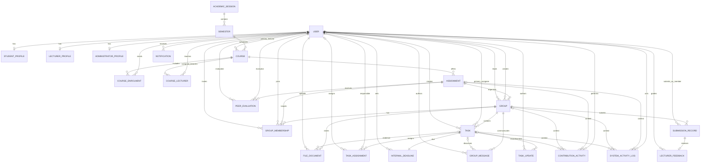

# UNILUS SGAMS database design

The application continues to use Django's ORM and the existing SQLite development database. The configured PostgreSQL backend remains available for deployment. Django migrations preserve existing records while normalizing profile, deadline, task-assignment, file, submission, and grading relationships.

## Entity relationship diagram

## Model mapping

| Requirement entity | Django model |
|---|---|
| User | `User` |
| Student Profile | `StudentProfile` |
| Lecturer Profile | `LecturerProfile` |
| Administrator Profile | `AdministratorProfile` |
| Course | `Course` |
| Academic Semester | `Semester` (within `AcademicSession`) |
| Assignment | `Assignment` |
| Group | `Group` |
| Group Membership | `GroupMembership` |
| Task | `Task` |
| Task Assignment | `TaskAssignment` |
| Internal Deadline | `InternalDeadline` |
| File and Document | `FileDocument` |
| Group Communication | `GroupMessage` |
| Submission Record | `Submission` |
| Contribution Activity | `ContributionActivity` |
| Lecturer Feedback | `Grade` |
| Peer Evaluation | `PeerReview` |
| Notification | `Notification` |
| System Activity Log | `ActivityLog` |

`CourseEnrolment` and `CourseLecturer` retain the existing course-to-user relationships.

## Relationship and integrity rules

- Role profiles use one-to-one foreign keys to the authentication user. New users receive the profile matching their role; the migration copies existing student, lecturer, and administrator data.
- Courses link to a `Semester`, which links to an `AcademicSession`. The existing semester/year form fields remain for compatibility and are used to resolve these records.
- Assignments store their instructions and objectives, publication timestamp, deadline, publication state, and group-formation rules. Student-facing pages and APIs expose only assignments published by the current time for active courses in which the student is enrolled.
- A group belongs to one assignment; its course is derived through that assignment. Groups record their formation type, approval status, capacity, and optional student leader. Tasks belong to a group, so their assignment is likewise unambiguous.
- `GroupMembership` stores its assignment, group, student, optional inviter, and membership status. Database constraints prevent duplicate group/student rows and multiple simultaneous group memberships for a student in one assignment; rejected records can be reused for a later request. Model validation checks course enrolment and reserves capacity for approved, pending, and invited members.
- Students may propose groups and invite enrolled classmates when assignment settings allow it. Proposals and join requests remain pending until lecturer approval. Invited students can view the invitation/proposal shell, but rosters and collaboration content require approved membership (or authorized lecturer/admin access).
- Tasks record priority, workflow status, creator, assignee, creation/update timestamps, and completion time. Their one-to-one `InternalDeadline` drives the automatically calculated overdue state; task updates and activity logs preserve progress/change history.
- Task assignees are recorded in `TaskAssignment`; only approved members of that task's group are accepted through the model save path.
- Group discussions are visible to approved members and authorized lecturers; a message may optionally reference a task in the same group.
- `InternalDeadline` is one-to-one with a task. `Task.deadline` remains a compatibility property backed by that record. `Task.updated_at` captures subsequent task changes.
- `FileDocument` links to one group and optionally a task. Its assignment is derived from the group, avoiding an independent assignment/group pair that could disagree. Shared group documents retain uploader, original filename, upload date, size, and version; new stored names are randomized, and download access is checked by the application.
- A submission belongs to a group; its assignment is derived from that group. A grade belongs to one submission; its group and assignment are derived from that submission. At most one submission per group can be marked latest.
- Database constraints protect unique group and assignment memberships, task assignees, unique peer evaluations, peer-evaluation score bounds and self-review, assignment group-size bounds, grade score bounds, and nonnegative file size.
- Rules involving multiple rows or tables (for example, whether a user is an approved member of a particular task's group) are validated by model and form code. Direct SQL writes that bypass the application should not be used for normal operations.
- Student actions are represented in both `ContributionActivity` (contribution reporting) and `ActivityLog` (system audit context). Activity remains an in-app record, not proof of offline effort.

## Migration and integration notes

Migrations `0003`–`0006` add the normalized tables, copy existing profile details, task deadlines/assignees, files, course-semester links, and student activity, then remove redundant relationship columns. Migration `0007` adds assignment objectives while preserving existing assignments. Migration `0008` adds group capacity, leadership, formation type, assignment-scoped membership, invitations, and assignment-wide membership uniqueness; it backfills existing memberships and refuses to proceed if legacy duplicates need resolution. Migration `0011` randomizes storage paths for new group and contribution documents; existing file names remain unchanged. Migration `0012` allows discussion messages to reference a task in the same group. Existing submission and grade records retain their IDs; their assignment/group context is derived from the authoritative parent relationship. Migration `0004` is intentionally irreversible because it consolidates and removes legacy tables; restore the pre-migration database backup to roll back.

For future Moodle integration, keep Moodle identifiers in a separate mapping/integration layer, scoped by source system and external ID. Do not use Moodle IDs as SGAMS primary keys or couple the core schema to one LMS.
